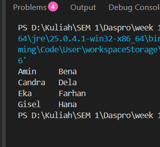
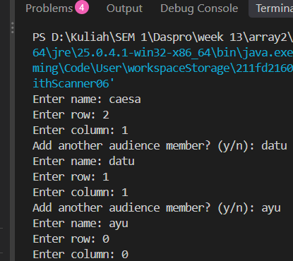
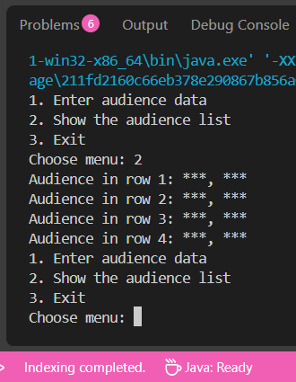
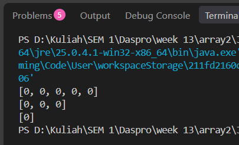
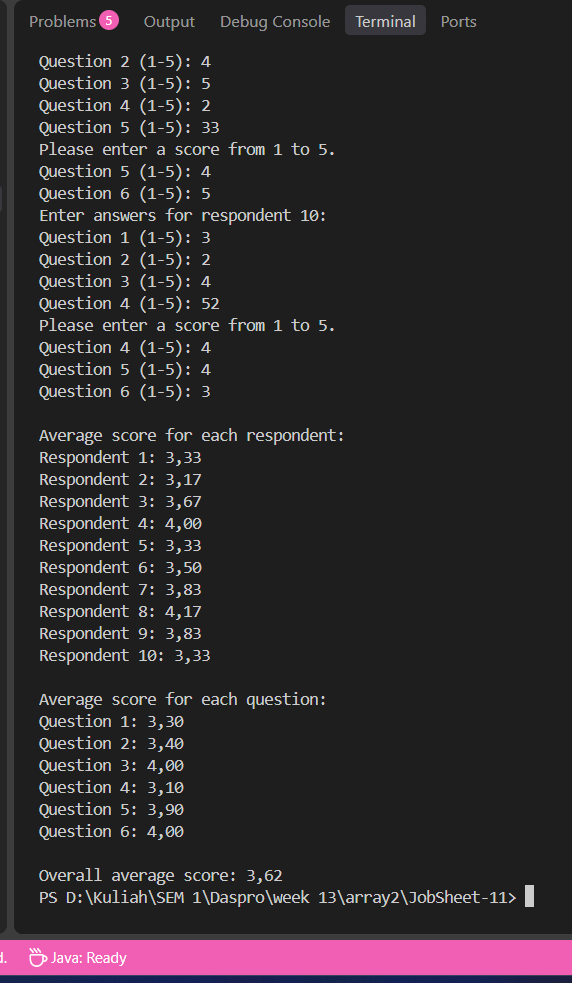

# JOBSHEET 11 - 2-Dimensional Arrays

**Student Identity:**
* **Name:** Datu Ayu Fitria Ceasa
* **NIM:** 264107020087
* **Class / Present number:** 1I / 06

---

## 1: OBJECTIVES

1. Declare, instantiate, and initialize 2-dimensional arrays in Java. 
2. Access and fill elements of a 2-dimensional array using row and column indices. 
3. Process 2-dimensional arrays with nested loops, using both for and foreach. 
4. Create 2-dimensional arrays whose rows have different lengths (*jagged arrays*).
5. Compute row averages and column averages in a real case study.

---

## 3: Lab Exercises

### 3.1. Experiment 1: Declaration, Initialization, and Displaying a 2-Dimensional Array 
#### 3.1.1 Java Code
```java
public class cinema06 {
    public static void main(String[] args) {
        String[][] audience = new String[4][2];

        audience[0][0] = "Amin"; 
        audience[0][1] = "Bena"; 
        audience[1][0] = "Candra"; 
        audience[1][1] = "Dela"; 
        audience[2][0] = "Eka"; 
        audience[2][1] = "Farhan"; 
        audience[3][0] = "Gisel"; 
        audience[3][1] = "Hana";

        System.out.printf("%s \t %s\n", audience[0][0], audience[0][1]);
        System.out.printf("%s \t %s\n", audience[1][0], audience[1][1]); 
        System.out.printf("%s \t %s\n", audience[2][0], audience[2][1]); 
        System.out.printf("%s \t %s\n", audience[3][0], audience[3][1]); 
        
    }
}
```

#### 3.1.2 Screenshot Output



#### 3.1.3 Questions
* **Question 1:** Must the elements of an array be filled in order, starting from index 0? Explain!
   * **Answer:** No, array elements do not have to be filled strictly in order from index 0. An array can be filled at any valid index, regardless of the surrounding elements.
* **Question 2:** Temporarily comment out the line audience[3][1] = "Hana";, then compile and run again. 
What is printed for row 4 now? Explain using the default values of arrays.   
  * **Answer:** When audience[3][1] = "Hana"; is commented out, the fourth row prints “Gisel null”. This happens because audience is a String[][] array, and the default value of an uninitialized array element of reference type String is null. The audience[3][0] element is assigned "Gisel", while audience[3][1] remains null.
   
* **Question 3:** Restore the line you commented out in Question 2. Why is it important to fill every element before the array is displayed? 
  * **Answer:** It is important to fill every array element before displaying the array because an uninitialized reference-type element has no meaningful data and will print as null. Restoring audience[3][1] = "Hana"; ensures that every element in the fourth row contains a name, so the displayed array is complete and does not show unexpected empty values. 
* **Question 4:** Add the following code after Step 4. Explain the purpose of audience.length and audience[0].length!
```
System.out.println(audience.length);
System.out.println(audience[0].length); 
System.out.println(audience[1].length); 
System.out.println(audience[2].length); 
System.out.println(audience[3].length);
```  
  * **Answer:** Taudience.length gives the number of elements in the first dimension (rows), while audience[row].length gives the number of elements in that specific row (columns).
* **Question 5:** Do audience[0].length, audience[1].length, audience[2].length, and audience[3].length have the same value? Why?  
 * **Answer:**  Yes, audience[0].length, audience[1].length, audience[2].length, and audience[3].length have the same value: 2.
This is because audience is declared as new String[4][2], which creates a two-dimensional array with 4 rows and 2 columns in every row. Therefore, each row has exactly 2 elements, and all four length expressions return 2.
* **Question 6:** Modify the code in Question 4 to display the length of every row using a for loop. Compile, run, and observe the result.
```
System.out.println(audience.length); 
for (int i = 0; i < audience.length; i++) { 
System.out.println("Length of row " + (i + 1) + ": " + 
audience[i].length); 
} 
```
 * **Answer:**
   The loop uses i to access each row from index 0 to audience.length - 1. Inside the loop, audience[i].length returns the number of columns in each row. Since audience has 4 rows and each row has 2 columns, every row length is 2. (i + 1) is used only to display row numbers beginning from 1 instead of array index 0.
* **Question 7:** Modify the code in Question 5 to display the length of every row using a foreach loop. Compile, run, and observe the result.
```
System.out.println(audience.length); 
for (String[] rowAudience : audience) { 
System.out.println("Row length: " + rowAudience.length); 
} 
```
  * **Answer:** 
 The loop automatically reads each String[] row from audience and stores it in rowAudience. Then, rowAudience.length displays the number of columns in that row. The foreach loop is easier to write because it does not require an index, but it does not provide the row number or allow direct control of array indices.
* **Question 8:** Add code to display the names in row 3 (index 2) using a for loop. Compile, run, and observe the result. 
```
System.out.println("Audience in row 3: "); 
for (int i = 0; i < audience[2].length; i++) { 
System.out.println(audience[2][i]); 
} 
```
  * **Answer:** audience[2] selects row 3 because array indexes start from 0. The loop variable i then moves from 0 to audience[2].length - 1, while audience[2][i] displays each name in that row. 
* **Question 9:** Modify the code in Question 8 to use a foreach loop. Compile, run, and observe the result.
```
System.out.println("Audience in row 3: "); 
for (String name : audience[2]) { 
System.out.println(name); 
}
```
  * **Answer:** audience[2] selects row 3, and the loop automatically assigns each String element in that row to name one by one. The output names are therefore printed in order. Unlike a regular for loop, the foreach loop does not use an index, making the code simpler.
* **Question 10:** Modify the code in Question 9 to display the audience of every row. Use String.join(), compile, run, and observe the result.
```
for (int i = 0; i < audience.length; i++) { 
System.out.println("Audience in row " + (i + 1) + ": " + String.join(", ", 
audience[i])); 
}
```
  * **Answer:** String.join(", ", audience[i]) combines all names in the specified row into one String, with commas and spaces between them. The regular for loop selects each row using i, and (i + 1) converts the array index into the displayed row number starting from 1.  
* **Question 11:**  In your opinion, what are the advantages and disadvantages of a foreach loop compared to a for loop? 
  * **Answer:** A foreach loop is simpler and safer because it automatically visits each element without manual index management. However, it cannot directly access or control an index, so it is less suitable when element positions or modifications at specific indices are needed. A for loop provides more flexibility for index-based access, but it requires more code and can cause errors if the index boundaries are wrong. 
* **Question 12:** What is the maximum row index of the array audience? Where does this value come from? 
  * **Answer:** The maximum row index is 3. It comes from audience.length, which is 4, because array indexes begin at 0. Therefore, valid indexes are 0 through 3. 
* **Question 13:** What is the maximum column index of the array audience? Is it the same for every row? 
  * **Answer:** The maximum column index is 1. It comes from audience[0].length, which is 2, and indexes begin at 0. In this array, every row has a length of 2, so every row has the same maximum column index, 1.
* **Question 14:** What does String.join() do? Explain the parameters it receives. 
  * **Answer:** String.join() combines array elements or a sequence of strings into one string. In String.join(", ", audience[i]), the first parameter is the separator ", " placed between elements, and the second parameter is the array of strings to join. For row 1, the result is "Amin, Bena".
---

### 3.2. Experiment 2: Scanner and Loops for Input and Output of a 2-Dimensional Array
#### 3.2.1 Java Code
```java
import java.util.Scanner;

public class CinemaWithScanner06 {
    public static void main(String[] args) {
        Scanner sc = new Scanner(System.in);
        int row, col;
        String name, choice; 
        String[][] audience = new String[4][2];

        while (true) { 
            System.out.print("Enter name: "); 
            name = sc.nextLine(); 
            System.out.print("Enter row: "); 
            row = sc.nextInt(); 
            System.out.print("Enter column: "); 
            col = sc.nextInt(); 
            sc.nextLine(); 

            audience[row - 1][col - 1] = name; 

            System.out.print("Add another audience member? (y/n): "); 
            choice = sc.nextLine(); 

            if (choice.equalsIgnoreCase("n")) { 
                break; 
            } 
        }   
    }
}

```



#### 3.2.3 Questions
* **Question 1:** Must the elements of an array be filled from Scanner in order, starting from index 0? explain! 
  * **Answer:**
    No, array elements filled using Scanner do not have to be filled sequentially from index 0. The program can place a name at any valid index specified by the user, such as audience[row][column], regardless of whether the preceding indices have already been filled. The scan order determines the order in which data is entered, not the required storage order of the array. However, entering data in sequence makes it easier to fill and display the array completely. If an element is entered before other elements, it will remain stored while the rest can be filled later.
* **Question 2:** Modify the program so that it shows the following menu:
```
1. Enter audience data 
2. Show the audience list 
3. Exit
```
  * **Answer:**
```
import java.util.Scanner;

public class CinemaWithScanner06 {
    public static void main(String[] args) {
        Scanner sc = new Scanner(System.in);
        int row, col;
        String name, choice; 
        String[][] audience = new String[4][2];

        while (true) {
            System.out.println("1. Enter audience data");
            System.out.println("2. Show the audience list");
            System.out.println("3. Exit");
            System.out.print("Choose menu: ");
            int menu = sc.nextInt();
            sc.nextLine();

            if (menu == 1) {
                while (true) {
                    System.out.print("Enter name: "); 
                    name = sc.nextLine(); 
                    System.out.print("Enter row: "); 
                    row = sc.nextInt(); 
                    System.out.print("Enter column: "); 
                    col = sc.nextInt(); 
                    sc.nextLine();

                    if (row >= 1 && row <= audience.length &&
                        col >= 1 && col <= audience[row - 1].length) {
                        audience[row - 1][col - 1] = name;
                    } else {
                        System.out.println("Invalid row or column.");
                    }

                    System.out.print("Add another audience member? (y/n): "); 
                    choice = sc.nextLine(); 

                    if (choice.equalsIgnoreCase("n")) { 
                        break; 
                    }
                }
            } else if (menu == 2) {
                for (int i = 0; i < audience.length; i++) {
                    System.out.println("Audience in row " + (i + 1) + ": " +
                        String.join(", ", audience[i]));
                }
            } else if (menu == 3) {
                break;
            } else {
                System.out.println("Invalid menu option.");
            }
        }

        sc.close();
    }
}
```
   
   
* **Question 3:** Modify the program to handle a row or column number that does not exist (for example row 7 or column 0).   
  * **Answer:**
1. A row below 1 or above 4 prints Invalid row number.
   
3. A column below 1 or above 2 prints Invalid column number.
   
5. The data is stored only when both indexes are valid.
* **Question 4:** In menu 1, display a warning if the chosen seat is already taken by another audience member, then ask for the row and column again.

Hint: A seat is taken when audience[row - 1][col - 1] != null. The range must also be 
checked against audience.length for rows, and audience[row - 1].length for columns.
  * **Answer:**
    The program now repeatedly requests the row and column after a seat is invalid or already occupied. A seat is accepted only when:

1. The row is valid: 1 to audience.length
2. The column is valid: 1 to audience[row - 1].length
3. audience[row - 1][col - 1] == null
* **Question 5:** In menu 2, if a seat is empty (null), display *** instead of null. 
  * **Answer:**
```
import java.util.Scanner;

public class CinemaWithScanner06 {
    public static void main(String[] args) {
        Scanner sc = new Scanner(System.in);
        int row, col;
        String name, choice; 
        String[][] audience = new String[4][2];

        while (true) {
            System.out.println("1. Enter audience data");
            System.out.println("2. Show the audience list");
            System.out.println("3. Exit");
            System.out.print("Choose menu: ");
            int menu = sc.nextInt();
            sc.nextLine();

            if (menu == 1) {
                while (true) {
                    System.out.print("Enter name: "); 
                    name = sc.nextLine(); 

                    while (true) {
                        System.out.print("Enter row: "); 
                        row = sc.nextInt(); 
                        System.out.print("Enter column: "); 
                        col = sc.nextInt(); 
                        sc.nextLine();

                        if (row < 1 || row > audience.length) {
                            System.out.println("Invalid row number.");
                        } else if (col < 1 || col > audience[row - 1].length) {
                            System.out.println("Invalid column number.");
                        } else if (audience[row - 1][col - 1] != null) {
                            System.out.println("Warning: That seat is already taken.");
                        } else {
                            audience[row - 1][col - 1] = name;
                            break;
                        }
                    }

                    System.out.print("Add another audience member? (y/n): "); 
                    choice = sc.nextLine(); 

                    if (choice.equalsIgnoreCase("n")) { 
                        break; 
                    }
                }
            } else if (menu == 2) {
                for (int i = 0; i < audience.length; i++) {
                    System.out.print("Audience in row " + (i + 1) + ": ");
                    for (int j = 0; j < audience[i].length; j++) {
                        if (j > 0) {
                            System.out.print(", ");
                        }
                        System.out.print(audience[i][j] == null ? "***" : audience[i][j]);
                    }
                    System.out.println();
                }
            } else if (menu == 3) {
                break;
            } else {
                System.out.println("Invalid menu option.");
            }
        }

        sc.close();
    }
}
```
 
 
### 3.3. Experiment 3: 2-Dimensional Array with Rows of Different Lengths

#### 3.3.1 Java Code
```java
import java.util.Arrays;

public class numbers06 {
    public static void main(String[] args) {
        int[][] myNumbers = new int[3][]; 
        myNumbers[0] = new int[5]; 
        myNumbers[1] = new int[3]; 
        myNumbers[2] = new int[1]; 

        for (int i = 0; i < myNumbers.length; i++) { 
            System.out.println(Arrays.toString(myNumbers[i])); 
        }
    }
}
```

#### 3.3.2 Screenshot Output



#### 3.3.3 Questions
* **Question 1:** What does Arrays.toString() do? 
  * **Answer:** Arrays.toString() converts a one-dimensional array into a readable String format, with each element separated by commas and enclosed in square brackets.
* **Question 2:** In Code 16, Arrays.toString() is called on myNumbers[i]. Change the call to Arrays.toString(myNumbers), then compile and run the program. What is displayed? Explain.   
  * **Answer:** Arrays.toString(myNumbers) cannot display the values of a two-dimensional array in a readable nested format because it treats myNumbers as a one-dimensional array of int[] elements. Consequently, it prints memory-address-like representations for those inner arrays. Arrays.deepToString(myNumbers) should be used to display the actual nested contents.
* **Question 3:** Also run System.out.println(Arrays.deepToString(myNumbers));. Compare the result with Code 16. Why is deepToString() needed for a 2-dimensional array?  
  * **Answer:** Compared with Code 16, Code 16 calls Arrays.toString(myNumbers[i]) inside the loop, so it prints one row at a time with its actual values. deepToString() is needed for a multidimensional array because a 2-dimensional array consists of inner arrays; toString() only converts the outer array and therefore cannot display the values inside each inner array.
* **Question 4:** What is the default value of an array element of type int?
  * **Answer:** The default value of an int array element is 0. Therefore, the output [0, 0, 0, 0, 0] is produced because none of the elements in myNumbers[0] has been assigned a value.
* **Question 5:** Add the following code to display the length of each row. Compile and run it, then observe the result.
```
for (int i = 0; i < myNumbers.length; i++) { 
System.out.println("Length of row " + (i + 1) + ": " + 
myNumbers[i].length); 
} 
```
  * **Answer:** The loop reads myNumbers[i].length, which gives the number of columns in each row. (i + 1) is used to display the row number starting from 1.
* **Question 6:** The array myNumbers has a different length for each row. Can the length of an array be changed after it has been instantiated? Explain.
  * **Answer:** No, the length of an array cannot be changed after it is instantiated in Java. myNumbers[0] has 5 elements, myNumbers[1] has 3, and myNumbers[2] has 1; these lengths remain fixed. However, a row in a jagged array can be replaced with a different-sized array, such as myNumbers[1] = new int[6];, but this changes the array assigned to that row, not the length of the original array object.
* **Question 7:** After instantiation, run myNumbers[0] = new int[7];, then print myNumbers.length and myNumbers[0].length. Which value changes? Why? 
  * **Answer:** myNumbers.length remains 3 because the number of rows in the outer array does not change. myNumbers[0].length changes from 5 to 7 because myNumbers[0] is replaced with a new one-dimensional array, new int[7].
  
### 3.4. Experiment 4: SIAKAD Case Study 

#### 3.4.1 Java Code
```java
public class scoreSearch06 {
    public static void main(String[] args) {
        int[] scores = {78, 65, 90, 55, 88, 72}; 
        int key = 90; 
        boolean found = false; 
        for (int i = 0; i < scores.length; i++) { 
            if (scores[i] == key) { 
                System.out.println("Score " + key + " was found at index " + i); 
                found = true; 
                break; 
            } 
        } 
        if (!found) { 
            System.out.println("Score " + key + " was not found."); 
        }
    }
}
```

#### Screenshot Output


#### 3.4.2 Questions
* **Question 1:** What if the number of students and the number of courses change? Modify the SIAKAD program so that both numbers can be decided while the program runs.

Hint: use Scanner to read the two values, then create the array with new 
int[numStudents][numCourses]. Make sure every loop uses length, not a fixed number.   
  * **Answer:** The loop runs once. A do-while loop executes its body before checking the condition. Since the first name is “cancel,” the break statement exits the loop during that first execution.
* **Question 2:** In Code 20, the variable totalPerStudent is declared inside the outer loop. What happens if you move the declaration outside the loop? Explain with an example of scores. 
  * **Answer:** The loop’s condition is while (true), which is always true. In practice, the loop stops when the customer enters “cancel” and the break statement runs.
* **Question 3:** If some scores have not been entered yet (they hold the default value 0), how does this affect the average?   
  * **Answer:** true makes the loop repeat indefinitely unless it is exited another way, such as with the break statement.


---

## 4: Assignment 

Implement the flowchart of the survey exercise from the Programming Fundamentals (theory) 
slides in a Java program. The survey data consists of 10 respondents and 6 questions with 
answers from 1 to 5. The program must: 

      
• store the survey results in a 2-dimensional array; 

• display the average score for each respondent; 

• display the average score for each question; 

• display the overall average score.
      

### 4.1 Task 1 Code Implementation

```java
import java.util.Scanner;

public class task2dimentionalarray06 {
    private static final int NUM_RESPONDENTS = 10;
    private static final int NUM_QUESTIONS = 6;

    public static void main(String[] args) {
        Scanner sc = new Scanner(System.in);
        int[][] surveyResults = new int[NUM_RESPONDENTS][NUM_QUESTIONS];
        int overallTotal = 0;

        for (int respondent = 0; respondent < NUM_RESPONDENTS; respondent++) {
            System.out.println("Enter answers for respondent " + (respondent + 1) + ":");

            for (int question = 0; question < NUM_QUESTIONS; question++) {
                int answer;
                do {
                    System.out.print("Question " + (question + 1) + " (1-5): ");
                    answer = sc.nextInt();
                    if (answer < 1 || answer > 5) {
                        System.out.println("Please enter a score from 1 to 5.");
                    }
                } while (answer < 1 || answer > 5);

                surveyResults[respondent][question] = answer;
                overallTotal += answer;
            }
        }

        System.out.println("\nAverage score for each respondent:");
        for (int respondent = 0; respondent < NUM_RESPONDENTS; respondent++) {
            int respondentTotal = 0;
            for (int question = 0; question < NUM_QUESTIONS; question++) {
                respondentTotal += surveyResults[respondent][question];
            }
            System.out.printf("Respondent %d: %.2f%n",
                    respondent + 1, (double) respondentTotal / NUM_QUESTIONS);
        }

        System.out.println("\nAverage score for each question:");
        for (int question = 0; question < NUM_QUESTIONS; question++) {
            int questionTotal = 0;
            for (int respondent = 0; respondent < NUM_RESPONDENTS; respondent++) {
                questionTotal += surveyResults[respondent][question];
            }
            System.out.printf("Question %d: %.2f%n",
                    question + 1, (double) questionTotal / NUM_RESPONDENTS);
        }

        System.out.printf("%nOverall average score: %.2f%n",
                (double) overallTotal / (NUM_RESPONDENTS * NUM_QUESTIONS));
    }
}

```


---
## 5: Reflection
#### 5.1 
Name two real-world situations that can be modeled with a 2-dimensional array, and 
explain what the rows and columns represent. 

1. A cinema seating system can use rows to represent seat rows and columns to represent seat positions. 

2. A student grade table can use rows to represent students and columns to represent subjects or assessment scores.

#### 5.2
What is the main difference between a square 2-dimensional array and a jagged array? 
Give one example use case for each. 

A square 2-dimensional array has the same number of columns in every row, such as new int[3][4], and is suitable for a fixed-size calendar or chessboard. A jagged array has variable row lengths, such as new int[3][], and is suitable for student records where different students have different numbers of scores.

#### 5.3
In which part of this jobsheet did you make index mistakes most often? How can you 
prevent them? 

Index mistakes occurred most often when row or column numbers entered by users began from 1 but Java array indexes began from 0. They can be prevented by checking index ranges before access and converting user indexes with row - 1 and col - 1.

## 6: Conclusion

The exercises demonstrate that Java arrays are accessed by zero-based indexes and can store data in a specific row and column. Two-dimensional arrays can be rectangular or jagged, allowing every row to have the same or different lengths, and array elements have default values such as null for String and 0 for int. Using Scanner allows users to enter and retrieve data, while validation is necessary to prevent invalid indexes and duplicate seat assignments. The for and foreach loops are useful for processing array elements, Arrays.toString() formats a one-dimensional array, and Arrays.deepToString() formats multidimensional arrays. Overall, the jobsheet shows that careful index conversion, range checking, and loop selection are important for handling arrays correctly.
